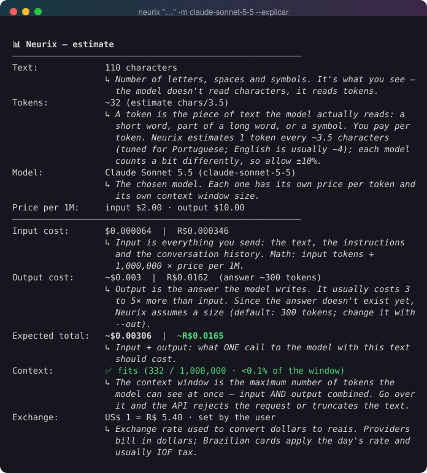
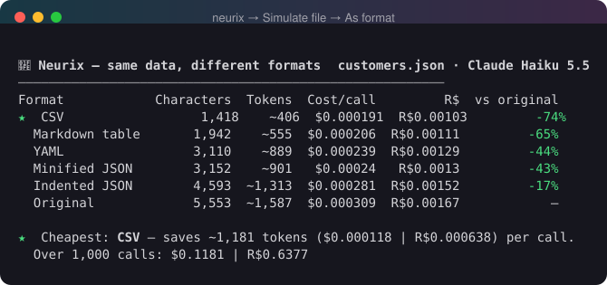
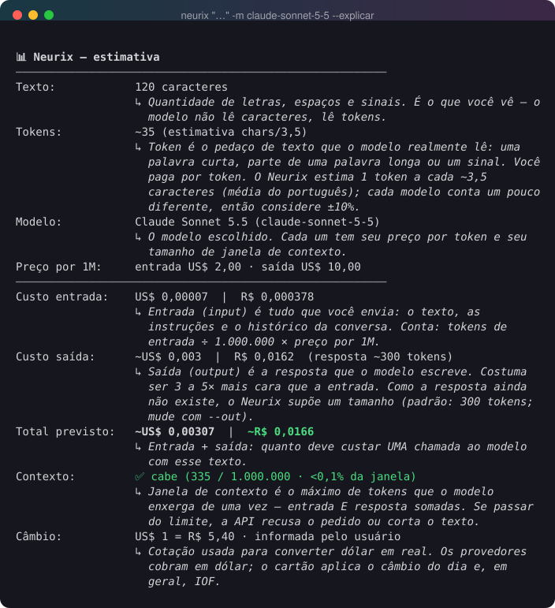
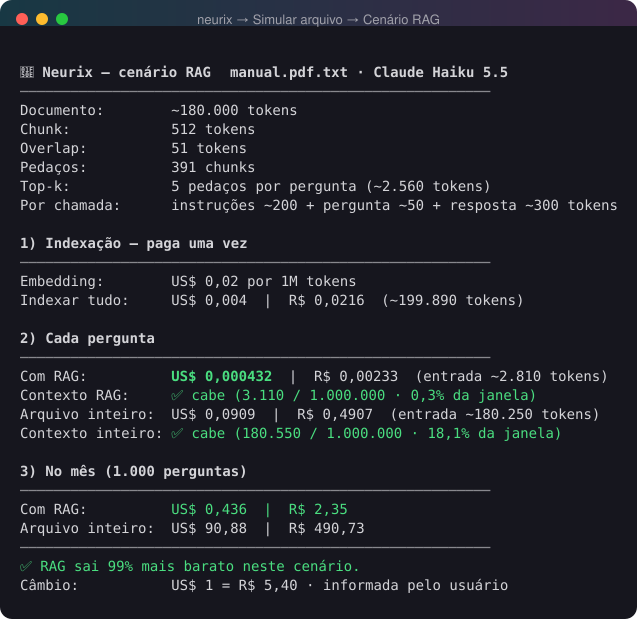
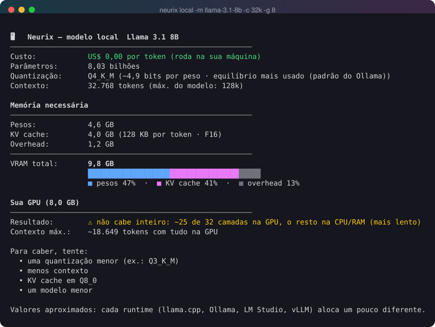

<a id="top"></a>

<div align="center">



<br>

<a href="https://www.npmjs.com/package/neurix"></a>
<a href="https://www.npmjs.com/package/neurix"></a>


<a href="LICENSE"></a>

<br><br>

### 🌐 **[English](#english)** &nbsp;·&nbsp; **[Português](#portugues)**

</div>

<a id="english"></a>

<div align="center">

**How many tokens? How much will it cost? Does it fit? Will it run on my GPU?**<br>
Neurix answers all of it in the terminal, and explains every number.

[Install](#-install) · [Demo](#-demo) · [Features](#-features) · [Usage](#-usage) · [Custom model](#%EF%B8%8F-custom-model) · [Reference](#-reference)

</div>


## 📦 Install

```bash
npm install -g aspael-neurix     # then just run: neurix
```

```bash
npx aspael-neurix                # or try it without installing
```

> Requires **Node.js 22.12+** · also works with `pnpm add -g neurix` and `yarn global add neurix`


## 🎬 Demo

<div align="center">
  
  <br>
  <sub>Real CLI output, rendered by <code>pnpm screenshots</code>. The neurons fire, the screens change on their own.</sub>
</div>


## ✨ Features

<table>
<tr>
<td width="33%" valign="top">

### 📝 Text
Tokens, input and output cost, total in **US$ and R$**, and how much of the **context window** it uses. Compare every model in one table.

</td>
<td width="33%" valign="top">

### 📄 Files
Send a file **as input**, find the cheapest **format** (JSON, YAML, CSV, Markdown), or simulate a **RAG** scenario per question and per month.

</td>
<td width="33%" valign="top">

### 🖥️ Local models
**Weights + KV cache + overhead = VRAM.** Checks whether it fits your GPU, how many layers offload and the largest context that fits.

</td>
</tr>
<tr>
<td valign="top">

### 🎓 Explained
Every result line comes with a `↳` that says what it means. Plus a full **glossary**: token, chunk, embedding, quantization, KV cache...

</td>
<td valign="top">

### 💱 Live exchange
Real-time **USD → BRL** with a 1-hour cache, several fallbacks and optional **IOF** tax. Never crashes: no rate, just dollars.

</td>
<td valign="top">

### 🧠 Animated & bilingual
An animated brain menu in 🇺🇸 **English** and 🇧🇷 **Portuguese**. Your choice is saved for next time.

</td>
</tr>
</table>


## 🚀 Usage

```bash
neurix                                        # 🧭 interactive menu
neurix "Explain what a token is"              # ⚖️  compare every model
neurix "Explain what a token is" -m claude-sonnet-5-5 --explicar
neurix local -m llama-3.1-8b -c 32k -g 8      # 🖥️  will it run on my 8 GB GPU?
neurix --lang en                              # 🌐 switch language
```

### 🧭 The menu

Run `neurix` with no arguments · **↑/↓** move · **Enter** confirm · **Ctrl+C** back.

| | Option | What it does |
|:-:|---|---|
| 📝 | **Simulate text** | Counts tokens, asks for the answer size, shows the cost per model or compares all |
| 📄 | **Simulate file** | A text file **as input**, **as format** or as a **RAG scenario** |
| 🖥️ | **Local model** | Weights, KV cache, overhead and VRAM, plus a check against your GPU |
| 📖 | **Glossary** | Every term in plain language |
| 🌐 | **Idioma / Language** | English ↔ Português |

### 📝 Every number, explained



### 📄 Same data, fewer tokens

Converting the same data between formats changes the price, not the information. Here **CSV uses 74% fewer tokens** than the original JSON:



<details>
<summary><b>🔎 RAG scenario</b>: index once, pay only for the relevant chunks</summary>
<br>


</details>

<details>
<summary><b>🖥️ Local model</b>: weights, KV cache, overhead and your GPU</summary>
<br>


Built-in models: `llama-3.2-1b` · `llama-3.2-3b` · `phi-3-mini` · `mistral-7b` · `qwen2.5-7b` · `llama-3.1-8b` · `qwen3-8b` · `gemma-2-9b` · `qwen2.5-14b` · `qwen2.5-32b` · `llama-3.1-70b`

</details>


## ✏️ Custom model

Not on the list? Choose **Custom**. Neurix shows where to find the numbers, then asks **5 questions** and explains each one before you answer.

**📍 Where to find them:** search the model on [huggingface.co](https://huggingface.co) → **Files and versions** → **config.json**<br>
Shortcut: `huggingface.co/<author>/<model>/blob/main/config.json`

**🦙 Using Ollama?** `ollama show <model> --verbose` → `block_count`, `head_count_kv`, `key_length`

| # | Question | Field in `config.json` | What it is | Affects |
|:-:|---|---|---|---|
| 1 | Parameters (billions) | — it's in the name: `7B` → 7 | Numbers the model learned | Weights |
| 2 | Layers | `num_hidden_layers` | Stacked blocks the text passes through | KV cache |
| 3 | KV heads | `num_key_value_heads` | Heads that store K/V (shared with GQA) | KV cache |
| 4 | Head dimension | `head_dim` | Vector size per head per token (64 / 128 / 256) | KV cache |
| 5 | Max context | `max_position_embeddings` | The most tokens the model accepts | Option limit |

> 💡 **No `num_key_value_heads`?** Use `num_attention_heads`. **No `head_dim`?** Type `0` and Neurix calculates it from `hidden_size ÷ num_attention_heads`. **Not sure?** Press **Enter** to use the Llama 3.1 8B example.


## 📚 Reference

<details>
<summary><b>⌨️ Text command options</b></summary>
<br>

```bash
neurix "your text"                          # compare every model
neurix "your text" -m claude-sonnet-5-5     # a specific model
cat file.txt | neurix -m gemini-4-argon     # text from stdin
```

| Option | What it does |
|---|---|
| `-m, --model <id>` | Specific model (e.g. `claude-sonnet-5-5`, `sonnet-5.5`) |
| `-o, --out <tokens>` | Expected answer size (default: 300) |
| `-e, --explicar` | Explains every line of the result |
| `-l, --lang <pt\|en>` | Interface language (overrides the saved one) |
| `-a, --all` | Shows every model, including older ones |
| `--usd <rate>` | Manual dollar rate in reais (e.g. `5.40`) |
| `--iof <pct>` | Adds Brazilian IOF tax on international purchases (e.g. `3.5`) |
| `--refresh-fx` | Ignores the cache and fetches the rate now |
| `--prices <file>` | Uses another price file |
| `-v, --version` | Shows the version |

`neurix cambio` shows the current US$ → R$ rate.

</details>

<details>
<summary><b>🖥️ <code>neurix local</code> options</b></summary>
<br>

```bash
neurix local                                              # interactive flow
neurix local "my prompt" -m qwen2.5-7b -g 12              # context = text tokens + answer
neurix local -m llama-3.1-70b -q Q3_K_M --kv q8_0 -g 24
```

| Option | What it does | Default |
|---|---|---|
| `-m, --model <id>` | Local model | opens the menu |
| `-q, --quant <type>` | `F16` `Q8_0` `Q6_K` `Q5_K_M` `Q4_K_M` `Q3_K_M` `Q2_K` | `Q4_K_M` |
| `-c, --context <tokens>` | Context to reserve (`8192` or `8k`; `k` = 1024) | `8k` |
| `--kv <type>` | KV cache precision: `F16` `Q8_0` `Q4_0` | `F16` |
| `-g, --gpu <GB>` | Your card's VRAM | — |
| `-p, --paralelo <n>` | Simultaneous conversations (multiplies KV cache) | `1` |
| `-o, --out <tokens>` | Answer tokens added to the text | `300` |
| `-e, --explicar` | Explains every line | off |

</details>

<details>
<summary><b>🧮 How it calculates</b></summary>
<br>

**Tokens:** ~1 token every **3.5 characters** (tuned for Portuguese; English is usually ~4). Allow **±10%**.

```
cost      = tokens ÷ 1,000,000 × price per 1M
total     = input cost + output cost

weights   = parameters × bits per weight ÷ 8
KV cache  = 2 (K and V) × layers × KV heads × head dim × bytes × context tokens
overhead  = ~0.5 GB runtime + ~0.3 GB buffers + 5%
VRAM      = weights + KV cache + overhead

chunks        = (document − overlap) ÷ (chunk − overlap)
RAG question  = instructions + question + top-k × chunk + answer
```

- **KV cache:** the conversation's short-term memory. For every token read, each layer stores a key (K) and a value (V). It grows linearly with context.
- **Overhead:** the runtime (CUDA/Metal, llama.cpp, Ollama), compute buffers and fragmentation.
- **VRAM:** graphics card memory. If it doesn't all fit, layers offload to CPU/RAM. That works, but slowly.
- **Exchange rate:** `--usd` / `NEURIX_USD` → 1 h cache → real-time commercial rate → Central Bank of Brazil (PTAX) → Frankfurter → old cache.

> Estimates: each runtime (llama.cpp, Ollama, LM Studio, vLLM) allocates a bit differently. The default embedding price (US$ 0.02/1M) is just a reference.

</details>

<details>
<summary><b>⚙️ Environment variables</b></summary>
<br>

| Variable | What it does |
|---|---|
| `NEURIX_LANG` | `pt` or `en` |
| `NEURIX_USD` | Fixed dollar rate (e.g. `5.40`) |
| `NEURIX_HOME` | Rate cache and saved language folder (default `~/.neurix`) |
| `NEURIX_NO_ANIM` | `1` turns animations off |

</details>

<details>
<summary><b>🛠️ Development & publishing</b></summary>
<br>

Requires **Node.js 22.18+** (runs TypeScript directly) and **pnpm**.

```bash
git clone https://github.com/Aspael/Neurix.git && cd Neurix
pnpm install
pnpm dev                     # run from source
pnpm build && pnpm link --global
```

| Script | What it does |
|---|---|
| `pnpm dev` | Runs the CLI from source |
| `pnpm build` | Bundles to `dist/cli.js` |
| `pnpm typecheck` | Type-checks |
| `pnpm screenshots` | Regenerates every README image (screenshots, demo, banners) |
| `pnpm prices:build` | Updates `data/models.json` from LiteLLM and OpenRouter |

**Publish:** `npm login` → `npm version patch` → `npm publish` (typecheck and build run first). The package ships only `dist/`, `README.md` and `LICENSE` (~40 kB).

**Texts:** every user-facing string lives in `src/i18n/en.ts` and `src/i18n/pt.ts`; `pnpm typecheck` catches missing keys.

</details>

<details>
<summary><b>🩺 Troubleshooting</b></summary>
<br>

- **`neurix local` hangs:** without text and without `-c`, it waits for stdin. Pass `-c 8k` or some text.
- **Values only in dollars:** the exchange APIs failed. Use `--usd 5.40`.
- **Odd emojis or animation on Windows:** use Windows Terminal, or set `NEURIX_NO_ANIM=1`.

</details>

<div align="right"><a href="#top">⬆ back to top</a></div>

<br>

<a id="portugues"></a>

<div align="center">


<br>

**Quantos tokens? Quanto vai custar? Cabe? Roda na minha GPU?**<br>
O Neurix responde tudo isso no terminal, e explica cada número.

[Instalação](#-instalação) · [Demo](#-demonstração) · [Recursos](#-recursos) · [Uso](#-uso) · [Modelo personalizado](#%EF%B8%8F-modelo-personalizado) · [Referência](#-referência)

</div>


## 📦 Instalação

```bash
npm install -g aspael-neurix     # depois é só rodar: neurix
```

```bash
npx aspael-neurix                # ou experimente sem instalar
```

> Requer **Node.js 22.12+** · também funciona com `pnpm add -g neurix` e `yarn global add neurix`


## 🎬 Demonstração

<div align="center">
  
  <br>
  <sub>Saída real da CLI, gerada por <code>pnpm screenshots</code>. Os neurônios disparam e as telas mudam sozinhas.</sub>
</div>


## ✨ Recursos

<table>
<tr>
<td width="33%" valign="top">

### 📝 Texto
Tokens, custo de entrada e saída, total em **US$ e R$** e quanto da **janela de contexto** ele ocupa. Compare todos os modelos numa tabela.

</td>
<td width="33%" valign="top">

### 📄 Arquivos
Mande um arquivo **como entrada**, descubra o **formato** mais barato (JSON, YAML, CSV, Markdown) ou simule um cenário **RAG** por pergunta e por mês.

</td>
<td width="33%" valign="top">

### 🖥️ Modelos locais
**Pesos + KV cache + overhead = VRAM.** Diz se cabe na sua GPU, quantas camadas vão para a CPU e o maior contexto que cabe.

</td>
</tr>
<tr>
<td valign="top">

### 🎓 Explicado
Cada linha do resultado vem com um `↳` dizendo o que significa. E um **glossário** completo: token, chunk, embedding, quantização, KV cache...

</td>
<td valign="top">

### 💱 Câmbio ao vivo
**US$ → R$** em tempo real, com cache de 1 hora, várias fontes reserva e **IOF** opcional. Nunca trava: sem cotação, mostra em dólar.

</td>
<td valign="top">

### 🧠 Animado e bilíngue
Menu com um cérebro animado, em 🇧🇷 **português** e 🇺🇸 **inglês**. A escolha fica salva para a próxima vez.

</td>
</tr>
</table>


## 🚀 Uso

```bash
neurix                                        # 🧭 menu interativo
neurix "Explique o que é um token"            # ⚖️  compara todos os modelos
neurix "Explique o que é um token" -m claude-sonnet-5-5 --explicar
neurix local -m llama-3.1-8b -c 32k -g 8      # 🖥️  roda na minha GPU de 8 GB?
neurix --lang pt                              # 🌐 troca o idioma
```

### 🧭 O menu

Rode `neurix` sem argumentos · **↑/↓** navega · **Enter** confirma · **Ctrl+C** volta.

| | Opção | O que faz |
|:-:|---|---|
| 📝 | **Simular texto** | Conta os tokens, pergunta o tamanho da resposta e mostra o custo por modelo, ou compara todos |
| 📄 | **Simular arquivo** | Um arquivo de texto **como entrada**, **como formato** ou em **cenário RAG** |
| 🖥️ | **Modelo local** | Pesos, KV cache, overhead e VRAM, e verifica sua GPU |
| 📖 | **Glossário** | Cada termo em linguagem simples |
| 🌐 | **Idioma / Language** | Português ↔ English |

### 📝 Cada número, explicado



### 📄 Mesmo dado, menos tokens

Trocar o formato muda o preço, não a informação. Aqui o **CSV gasta 74% menos tokens** que o JSON original:


<details>
<summary><b>🔎 Cenário RAG</b>: indexa uma vez e paga só pelos pedaços relevantes</summary>
<br>



</details>

<details>
<summary><b>🖥️ Modelo local</b>: pesos, KV cache, overhead e a sua GPU</summary>
<br>



Modelos prontos: `llama-3.2-1b` · `llama-3.2-3b` · `phi-3-mini` · `mistral-7b` · `qwen2.5-7b` · `llama-3.1-8b` · `qwen3-8b` · `gemma-2-9b` · `qwen2.5-14b` · `qwen2.5-32b` · `llama-3.1-70b`

</details>


## ✏️ Modelo personalizado

Não está na lista? Escolha **Personalizado**. O Neurix mostra onde achar os números, faz **5 perguntas** e explica cada uma antes de você responder.

**📍 Onde achar:** pesquise o modelo em [huggingface.co](https://huggingface.co) → **Files and versions** → **config.json**<br>
Atalho: `huggingface.co/<autor>/<modelo>/blob/main/config.json`

**🦙 Usa Ollama?** `ollama show <modelo> --verbose` → `block_count`, `head_count_kv`, `key_length`

| # | Pergunta | Campo no `config.json` | O que é | Afeta |
|:-:|---|---|---|---|
| 1 | Parâmetros (bilhões) | — está no nome: `7B` → 7 | Números que o modelo aprendeu | Pesos |
| 2 | Camadas | `num_hidden_layers` | Blocos empilhados que o texto atravessa | KV cache |
| 3 | Cabeças KV | `num_key_value_heads` | Cabeças que guardam K/V (compartilhadas com GQA) | KV cache |
| 4 | Dimensão da cabeça | `head_dim` | Tamanho do vetor por cabeça por token (64 / 128 / 256) | KV cache |
| 5 | Contexto máximo | `max_position_embeddings` | Maior número de tokens que o modelo aceita | Limite das opções |

> 💡 **Sem `num_key_value_heads`?** Use `num_attention_heads`. **Sem `head_dim`?** Digite `0` e o Neurix calcula a partir de `hidden_size ÷ num_attention_heads`. **Na dúvida?** Aperte **Enter** para usar o exemplo do Llama 3.1 8B.


## 📚 Referência

<details>
<summary><b>⌨️ Opções do comando de texto</b></summary>
<br>

```bash
neurix "seu texto"                          # compara todos os modelos
neurix "seu texto" -m claude-sonnet-5-5     # um modelo específico
cat arquivo.txt | neurix -m gemini-4-argon  # texto via stdin
```

| Opção | O que faz |
|---|---|
| `-m, --model <id>` | Modelo específico (ex.: `claude-sonnet-5-5`, `sonnet-5.5`) |
| `-o, --out <tokens>` | Tamanho estimado da resposta (padrão: 300) |
| `-e, --explicar` | Explica cada linha do resultado |
| `-l, --lang <pt\|en>` | Idioma da interface (sobrepõe o salvo) |
| `-a, --all` | Mostra todos os modelos, inclusive os antigos |
| `--usd <cotação>` | Cotação manual do dólar (ex.: `5.40`) |
| `--iof <pct>` | Soma IOF de compra internacional (ex.: `3.5`) |
| `--refresh-fx` | Ignora o cache e busca a cotação agora |
| `--prices <arquivo>` | Usa outro arquivo de preços |
| `-v, --version` | Mostra a versão |

`neurix cambio` mostra a cotação atual do dólar.

</details>

<details>
<summary><b>🖥️ Opções do <code>neurix local</code></b></summary>
<br>

```bash
neurix local                                              # fluxo interativo
neurix local "meu prompt" -m qwen2.5-7b -g 12             # contexto = tokens do texto + resposta
neurix local -m llama-3.1-70b -q Q3_K_M --kv q8_0 -g 24
```

| Opção | O que faz | Padrão |
|---|---|---|
| `-m, --model <id>` | Modelo local | abre o menu |
| `-q, --quant <tipo>` | `F16` `Q8_0` `Q6_K` `Q5_K_M` `Q4_K_M` `Q3_K_M` `Q2_K` | `Q4_K_M` |
| `-c, --context <tokens>` | Contexto a reservar (`8192` ou `8k`; `k` = 1024) | `8k` |
| `--kv <tipo>` | Precisão do KV cache: `F16` `Q8_0` `Q4_0` | `F16` |
| `-g, --gpu <GB>` | VRAM da sua placa | — |
| `-p, --paralelo <n>` | Conversas simultâneas (multiplica o KV cache) | `1` |
| `-o, --out <tokens>` | Resposta somada ao texto | `300` |
| `-e, --explicar` | Explica cada linha | desligado |

</details>

<details>
<summary><b>🧮 Como os cálculos funcionam</b></summary>
<br>

**Tokens:** ~1 token a cada **3,5 caracteres** (média do português; o português gasta de 20% a 30% mais tokens que o inglês). Considere **±10%**.

```
custo     = tokens ÷ 1.000.000 × preço por 1M
total     = custo de entrada + custo de saída

pesos     = parâmetros × bits por peso ÷ 8
KV cache  = 2 (K e V) × camadas × cabeças KV × dim. da cabeça × bytes × tokens de contexto
overhead  = ~0,5 GB runtime + ~0,3 GB buffers + 5%
VRAM      = pesos + KV cache + overhead

chunks            = (documento − overlap) ÷ (chunk − overlap)
pergunta com RAG  = instruções + pergunta + top-k × chunk + resposta
```

- **KV cache:** a memória de curto prazo da conversa. Para cada token lido, cada camada guarda uma chave (K) e um valor (V). Cresce em linha reta com o contexto.
- **Overhead:** o runtime (CUDA/Metal, llama.cpp, Ollama), os buffers dos cálculos e a fragmentação.
- **VRAM:** a memória da placa de vídeo. Se não couber tudo, camadas vão para a CPU/RAM. Funciona, mas devagar.
- **Câmbio:** `--usd` / `NEURIX_USD` → cache de 1 h → cotação comercial em tempo real → Banco Central (PTAX) → Frankfurter → cache antigo.

> São estimativas: cada runtime (llama.cpp, Ollama, LM Studio, vLLM) aloca um pouco diferente. O preço padrão do embedding (US$ 0,02/1M) é só uma referência.

</details>

<details>
<summary><b>⚙️ Variáveis de ambiente</b></summary>
<br>

| Variável | O que faz |
|---|---|
| `NEURIX_LANG` | `pt` ou `en` |
| `NEURIX_USD` | Cotação fixa do dólar (ex.: `5.40`) |
| `NEURIX_HOME` | Pasta do cache de câmbio e do idioma salvo (padrão `~/.neurix`) |
| `NEURIX_NO_ANIM` | `1` desliga as animações |

</details>

<details>
<summary><b>🛠️ Desenvolvimento e publicação</b></summary>
<br>

Requer **Node.js 22.18+** (roda o TypeScript direto) e **pnpm**.

```bash
git clone https://github.com/Aspael/Neurix.git && cd Neurix
pnpm install
pnpm dev                     # roda a partir do código-fonte
pnpm build && pnpm link --global
```

| Script | O que faz |
|---|---|
| `pnpm dev` | Roda a CLI direto do código-fonte |
| `pnpm build` | Compila para `dist/cli.js` |
| `pnpm typecheck` | Verifica os tipos |
| `pnpm screenshots` | Gera de novo todas as imagens do README (telas, demo, banners) |
| `pnpm prices:build` | Atualiza `data/models.json` a partir do LiteLLM e da OpenRouter |

**Publicar:** `npm login` → `npm version patch` → `npm publish` (typecheck e build rodam antes). O pacote leva só `dist/`, `README.md` e `LICENSE` (~40 kB).

**Textos:** todos os textos da interface ficam em `src/i18n/pt.ts` e `src/i18n/en.ts`; o `pnpm typecheck` avisa se faltar alguma chave.

</details>

<details>
<summary><b>🩺 Problemas comuns</b></summary>
<br>

- **`neurix local` fica parado:** sem texto e sem `-c`, ele espera texto pela entrada padrão. Passe `-c 8k` ou um texto.
- **Valores só em dólar:** as APIs de câmbio falharam. Use `--usd 5.40`.
- **Emojis ou animação estranhos no Windows:** use o Windows Terminal, ou `NEURIX_NO_ANIM=1`.

</details>

<div align="right"><a href="#top">⬆ voltar ao topo</a></div>


<div align="center">
  
  <br>
  <sub>Made with 🧠 and TypeScript · Feito com 🧠 e TypeScript · <a href="LICENSE">MIT</a></sub>
</div>
