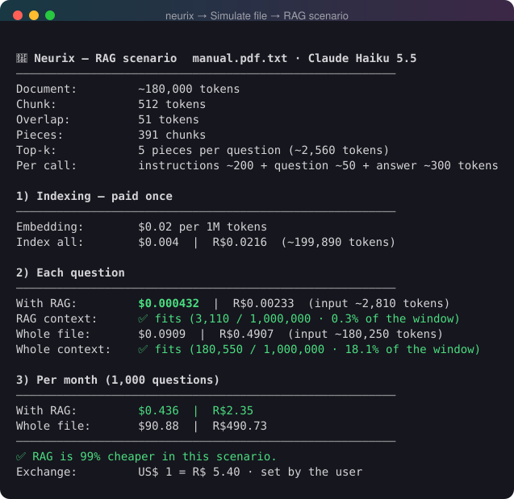
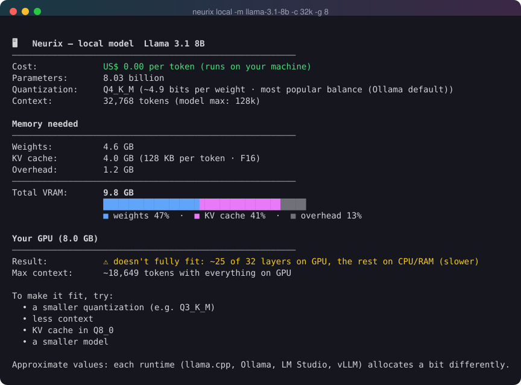
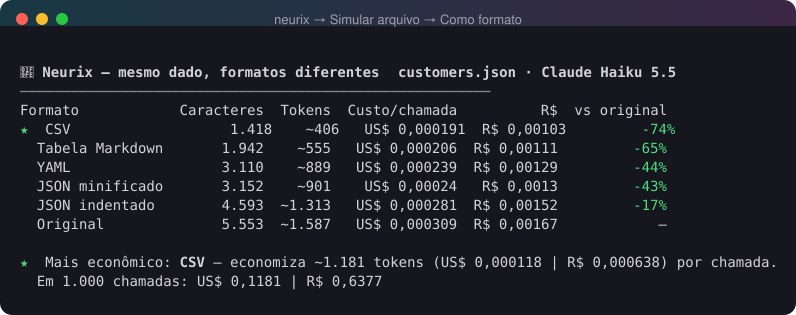

<a id="top"></a>

<div align="center">


<br>

<a href="https://www.npmjs.com/package/aspael-neurix"></a>
<a href="https://www.npmjs.com/package/aspael-neurix"></a>

<a href="https://github.com/Aspael/Neurix/actions/workflows/ci.yml"></a>


<a href="LICENSE"></a>

<br><br>

### 🌐 **[English](#english)** &nbsp;·&nbsp; **[Português](#portugues)**

</div>

<a id="english"></a>

<div align="center">

**How many tokens? How much will it cost? Does it fit? Will it run on my GPU?**<br>
Neurix answers all of it in the terminal, and explains every number.

[Install](#-install) · [Demo](#-demo) · [Features](#-features) · [Usage](#-usage) · [Custom model](#%EF%B8%8F-custom-model) · [Reference](#-reference) · [Changelog](#-changelog)

</div>


## 📦 Install

```bash
npm install -g aspael-neurix   # then just run: neurix
```

```bash
npx aspael-neurix             # or try it without installing
```

> Requires **Node.js 22.12+** · also works with `pnpm add -g aspael-neurix` and `yarn global add aspael-neurix`


## 🎬 Demo

<div align="center">
  
  <br>
  <sub>Real CLI output, rendered by <code>pnpm screenshots</code>. The neurons fire, the screens change on their own.</sub>
</div>


## ✨ Features

<table>
<tr>
<td width="33%" valign="top">

### 📝 Text
Tokens, input and output cost, total in **US$ and R$**, and how much of the **context window** it uses. Compare every model in one table.

</td>
<td width="33%" valign="top">

### 📄 Files
Send a file **as input**, find the cheapest **format** (JSON, YAML, CSV, Markdown), or simulate a **RAG** scenario per question and per month.

</td>
<td width="33%" valign="top">

### 🖥️ Local models
**Weights + KV cache + overhead = VRAM.** Checks whether it fits your GPU, how many layers offload and the largest context that fits.

</td>
</tr>
<tr>
<td valign="top">

### 🎓 Explained
Every result line comes with a `↳` that says what it means. Plus a full **glossary**: token, chunk, embedding, quantization, KV cache...

</td>
<td valign="top">

### 💱 Live exchange
Real-time **USD → BRL** with a 1-hour cache, several fallbacks and optional **IOF** tax. Never crashes: no rate, just dollars.

</td>
<td valign="top">

### 🧠 Animated & bilingual
An animated brain menu in 🇺🇸 **English** and 🇧🇷 **Portuguese**. Your choice is saved for next time.

</td>
</tr>
</table>


## 🚀 Usage

```bash
neurix                                        # 🧭 interactive menu
neurix "Explain what a token is"              # ⚖️  compare every model
neurix "Explain what a token is" -m claude-sonnet-5-5 --explain
neurix local -m llama-3.1-8b -c 32k -g 8      # 🖥️  will it run on my 8 GB GPU?
neurix --lang en                              # 🌐 switch language
```

### 🧭 The menu

Run `neurix` with no arguments · **↑/↓** move · **Enter** confirm · **Ctrl+C** back.

| | Option | What it does |
|:-:|---|---|
| 📝 | **Simulate text** | Counts tokens, asks for the answer size, shows the cost per model or compares all |
| 📄 | **Simulate file** | A text file **as input**, **as format** or as a **RAG scenario** |
| 🖥️ | **Local model** | Weights, KV cache, overhead and VRAM, plus a check against your GPU |
| 📖 | **Glossary** | Every term in plain language |
| 🌐 | **Idioma / Language** | English ↔ Português |

### 📝 Every number, explained


### 📄 Same data, fewer tokens

Converting the same data between formats changes the price, not the information. Here **CSV uses 74% fewer tokens** than the original JSON:


<details>
<summary><b>🔎 RAG scenario</b>: index once, pay only for the relevant chunks</summary>
<br>



</details>

<details>
<summary><b>🖥️ Local model</b>: weights, KV cache, overhead and your GPU</summary>
<br>



Built-in models: `llama-3.2-1b` · `llama-3.2-3b` · `phi-3-mini` · `mistral-7b` · `qwen2.5-7b` · `llama-3.1-8b` · `qwen3-8b` · `gemma-2-9b` · `qwen2.5-14b` · `qwen2.5-32b` · `llama-3.1-70b`

</details>


## ✏️ Custom model

Not on the list? Choose **Custom**. Neurix shows where to find the numbers, then asks **5 questions** and explains each one before you answer.

**📍 Where to find them:** search the model on [huggingface.co](https://huggingface.co) → **Files and versions** → **config.json**<br>
Shortcut: `huggingface.co/<author>/<model>/blob/main/config.json`

**🦙 Using Ollama?** `ollama show <model> --verbose` → `block_count`, `head_count_kv`, `key_length`

| # | Question | Field in `config.json` | What it is | Affects |
|:-:|---|---|---|---|
| 1 | Parameters (billions) | — it's in the name: `7B` → 7 | Numbers the model learned | Weights |
| 2 | Layers | `num_hidden_layers` | Stacked blocks the text passes through | KV cache |
| 3 | KV heads | `num_key_value_heads` | Heads that store K/V (shared with GQA) | KV cache |
| 4 | Head dimension | `head_dim` | Vector size per head per token (64 / 128 / 256) | KV cache |
| 5 | Max context | `max_position_embeddings` | The most tokens the model accepts | Option limit |

> 💡 **No `num_key_value_heads`?** Use `num_attention_heads`. **No `head_dim`?** Type `0` and Neurix calculates it from `hidden_size ÷ num_attention_heads`. **Not sure?** Press **Enter** to use the Llama 3.1 8B example.


## 📖 Manual and always-current prices

**📖 Manual** (menu → *📖 Manual*, or `neurix manual`) — made for beginners:

- **🚀 Getting started** — the 6 most common questions and where to answer them.
- **Glossary by category** — 🔤 the basics · 💰 money · 📄 files and RAG · 🖥️ models on your PC · ⚡ power and hardware · 🔌 integrations. Every term in plain language: token, tokenizer, exact × estimate, prompt caching, batch, GGUF, KV cache, tokens/s, TDP, kWh, MCP…
- **⌨️ Every command** — all of them, with every option, its default and examples. Generated from the CLI itself, so it never goes out of date.

```bash
neurix manual            # everything
neurix manual budget     # one command
neurix manual "kv cache" # looks up a term
neurix manual --commands # only the commands
```

**🏷️ Prices update themselves.** A scheduled GitHub Actions workflow ([`prices.yml`](.github/workflows/prices.yml)) runs **every day**, fetches prices from LiteLLM and OpenRouter, regenerates `data/models.json`, runs the tests and commits it (or opens a PR with `PRICES_MODE=pr`). Neurix then downloads that table at most once a day (cached in `~/.neurix/models.json`), so **you get new prices without reinstalling**. `neurix prices` shows where the table came from; `neurix prices --refresh` forces a download; `NEURIX_OFFLINE=1` never touches the network.


## 🖥️ Local models, for real

| | What it does | Command |
|---|---|---|
| 🔍 **Hardware detection** | Finds your GPU and VRAM by itself — NVIDIA via `nvidia-smi` (free VRAM, **live power draw** and power limit), AMD/Intel via the Windows registry or Linux `/sys`, Apple Silicon unified memory — plus RAM, CPU, memory bandwidth and TDP, and the biggest model that runs well. No more typing your VRAM. | `neurix hardware` |
| 📦 **Installed models** | Reads the GGUF files of **Ollama** (even with Ollama closed) and **LM Studio** straight from disk: real architecture, exact parameter count, real quantization and size — and says which ones run well on your PC (GPU, GPU+CPU, CPU) with estimated tokens/s. | `neurix installed` |
| 🤗 **Hugging Face import** | The custom model no longer needs 5 questions: type the name, Neurix searches Hugging Face, downloads `config.json` and fills layers, KV heads, head dimension, context and parameters. Gated repos suggest open copies. The 5 questions are still there for when the Hub isn't reachable. | `neurix local --hf Qwen/Qwen2.5-7B-Instruct` |
| ⚖️ **Local vs API** | Electricity (hours × watts × your kWh price) + optional GPU amortization vs paying each API for the same tokens — with the month the GPU pays for itself. *"Is running Llama 70B locally cheaper than GPT?"* | `neurix local-vs-api -m llama-3.1-8b -r 2000 --hardware 2500` |
| ⚡ **Real benchmark** | Runs a prompt on Ollama and **measures** prompt and generation tokens/s and, with NVIDIA, the GPU's power every 0.5 s → kWh per 1M tokens. | `neurix benchmark llama3.2:3b` |

`neurix local` now uses the detected GPU automatically (`-g` simulates another card) and also shows the **estimated speed**.

### 📤 Export reports

Every result — cost, comparison, formats, RAG, local model, hardware, installed models, local vs API, benchmark, optimizer, folder, chunks, recommender, budget, check, cache — can be saved as **Markdown, CSV, JSON or HTML**: in the menu choose **📤 Export this result**; in the terminal add `--export` (the format comes from the extension):

```bash
neurix budget --cap 200 --requests 150 --export budget.html
neurix folder . --export tokens.csv
neurix local-vs-api -m llama-3.1-70b -g 48 -x local-vs-api.md
```


## 🧰 Tools

In the menu, **🧰 Tools** opens the extra tools. Most of them also run straight from the terminal:

| Tool | What it does | Command |
|---|---|---|
| ✂️ **Prompt optimizer** | Points out wasted tokens — indented JSON, trailing spaces, indentation, repeated spaces, extra blank lines, invisible characters — showing the exact lines (`·` = space, `→` = tab), how many tokens each one costs and the savings per call and per 1,000 calls. Repeated lines are only pointed out. Saves the optimized version. | `neurix optimize prompt.txt --save prompt.min.txt` |
| 📁 **Folder / repository analysis** | Counts the tokens of every file (skips `node_modules`, `.git`, builds, binaries, lockfiles and `.gitignore`), with the largest files, totals per type and per folder, and whether everything fits each model's context. | `neurix folder . --ext ts,md` |
| 🧩 **Visual RAG chunking** | Draws the document map with every chunk, the overlap (`▒`) and the new content (`█`), shows the start and end of each chunk and flags cuts in the middle of a sentence (`✂`). Cuts by real tokens with the OpenAI tokenizer. | `neurix chunks doc.md -s 512 --overlap 10` |
| 🎯 **Model recommender** | Reads the prompt, suggests the quality level it needs (code, reasoning, math, size, simple tasks) and says which model is the cheapest **today** that fits, with alternatives and the cheapest of each level. | `neurix recommend "Translate to English: good morning"` |
| 💰 **Neurix Budget** | Set a **monthly cap** (e.g. R$ 200) and your usage (requests/day, days, input, fixed part, batch share): cost per request in 4 strategies (normal, +cache, +batch, cache+batch), **projection per day/month/year**, % of the cap, the **day the cap runs out**, alerts at 80/100%, how many requests fit, and your **spending pace** (`--spent`). Batch per provider: OpenAI, Anthropic and Google −50%. | `neurix budget --cap 200 --requests 150 --days 22 --fixed-pct 70 --batch 30 --spent 120` |
| 🚦 **Neurix check** | **Cost alert** for a file or folder: exits with code **1** when it goes over `--max-usd`, `--max-brl` or `--max-tokens` (or doesn't fit the context), **2** on usage errors. `--json` for scripts. | `neurix check prompt.md --max-brl 0.50 --calls 1000` |
| ♻️ **Prompt caching** | How much you save when the same fixed part (instructions, document) is repeated and the provider bills cached tokens cheaper. | menu |

> 🚦 **In CI / pre-commit:** fail the build when a prompt gets too expensive:
> ```yaml
> - run: npx -y -p aspael-neurix neurix check prompts/ --max-usd 0.05 -m claude-sonnet-5-5
> ```


## 🔌 MCP server (use Neurix inside any AI)

Neurix ships an **MCP server** (Model Context Protocol), so Claude Code, Claude Desktop, Cursor, VS Code, Windsurf, Gemini CLI and any other MCP client can count tokens, price calls and plan local models for you — just ask in plain language (*"how much does this prompt cost on Sonnet vs GPT?"*, *"what fits on my 8 GB GPU?"*).

It runs locally over **stdio**. Start it with `neurix-mcp` or `neurix mcp`.

<details>
<summary><b>⚙️ Setup per client</b></summary>

**Claude Code**
```bash
claude mcp add neurix -- npx -y -p aspael-neurix neurix-mcp
```

**Claude Desktop · Cursor · Windsurf · Gemini CLI** (`claude_desktop_config.json`, `.cursor/mcp.json`, `~/.codeium/windsurf/mcp_config.json`, `~/.gemini/settings.json`)
```json
{
  "mcpServers": {
    "neurix": { "command": "npx", "args": ["-y", "-p", "aspael-neurix", "neurix-mcp"] }
  }
}
```

**VS Code** (`.vscode/mcp.json`)
```json
{
  "servers": {
    "neurix": { "type": "stdio", "command": "npx", "args": ["-y", "-p", "aspael-neurix", "neurix-mcp"] }
  }
}
```

**From a local clone** — run `pnpm build` and use `"command": "node", "args": ["/path/to/Neurix/dist/mcp.js"]`.

**Optional environment variables:** `NEURIX_LANG=en|pt` (language of the explanations) · `HF_TOKEN` (gated Hugging Face repos) · `NEURIX_PRICES` (custom price file) · `NEURIX_HOME` (cache folder, default `~/.neurix`).

> On Windows, if `npx` isn't found, use `"command": "cmd", "args": ["/c", "npx", "-y", "-p", "aspael-neurix", "neurix-mcp"]`.

</details>

**🧰 Tools**

| Tool | What it does | Main inputs |
|---|---|---|
| `neurix_count_tokens` | Counts the tokens of a text. With `model`, uses that model's tokenizer; without it, returns OpenAI (exact), Claude and Gemini (estimates, with the reason) and optionally every local model (exact). | `text`, `model?`, `include_local?` |
| `neurix_estimate_cost` | Cost of **one call** to an API model in USD and BRL: input + output, the price actually applied (long-context tiers, scheduled changes), and whether it fits the context window. `calls` multiplies it (e.g. per month). | `model`, `text` or `input_tokens`, `output_tokens`, `calls`, `usd_brl?`, `iof_pct` |
| `neurix_compare_models` | Ranks the models from cheapest to most expensive for the same call; each one counts with its own tokenizer and the ones that don't fit are flagged. Returns `cheapest_that_fits`. | `text` or `input_tokens`, `output_tokens`, `providers?`, `include_all` |
| `neurix_suggest_format` | Converts the same data to indented/minified JSON, YAML, CSV, Markdown table or compacted text, measures each one and says which is cheapest and how much it saves per call and per 1,000 calls. | `content`, `filename?`, `model`, `include_converted` |
| `neurix_check_local_fit` | Memory to run a model on your PC: weights + KV cache + overhead. With `vram_gb`, says whether it fits, how many layers go to the GPU, the largest context that fits and what to change. Works with a `custom` model from its `config.json`. | `model` or `custom`, `quant`, `context` or `text`, `kv`, `vram_gb?`, `parallel` |
| `neurix_find_local_models` | *"What can I run on my GPU?"* — for each known local model, the best-quality quantization that still fits entirely in the VRAM, largest model first. | `vram_gb`, `context`, `kv`, `min_quality` |
| `neurix_rag_cost` | RAG (chunks + embeddings, only the top-K go to the model) vs sending the whole document every time: chunks, indexing cost, cost per question and per month, and savings. | `model`, `text` or `doc_tokens`, `chunk_size`, `overlap_pct`, `top_k`, `queries_per_month` |
| `neurix_count_file` | Reads a text file from disk (up to 20 MB) and returns characters, tokens, cost as input and whether it fits the context — before you attach it. | `path`, `model` |
| `neurix_list_models` | Every model Neurix knows: API models (price, context, exact or estimated count) and local models (parameters, layers, tokenizer), plus quantizations and KV precisions. Use it to find ids. | `kind`, `provider?`, `include_all` |
| `neurix_exchange_rate` | Current USD → BRL rate (AwesomeAPI, with Central Bank PTAX and Frankfurter as fallbacks), optionally converting an amount with IOF. | `amount_usd?`, `iof_pct`, `refresh` |
| `neurix_explain_term` | Plain-language glossary: token, context window, RAG, chunk, embedding, quantization, KV cache, VRAM, offload… | `term?`, `lang?` |
| `neurix_optimize_prompt` | Finds wasted tokens (indented JSON, trailing/repeated spaces, indentation, blank lines, invisible characters), with the exact lines, tokens saved per issue, money saved and the optimized text. | `text` or `path`, `model` |
| `neurix_analyze_folder` | Tokens per file of a folder or repository (respects `.gitignore`, skips builds/binaries/lockfiles): largest files, totals per extension and per folder, and whether it all fits each model. | `path`, `model`, `top`, `extensions?` |
| `neurix_chunk_document` | Splits a document into RAG chunks by real tokens: token range of each chunk, the overlap, preview or full text, which ones cut a sentence, and advice. | `text` or `path`, `chunk_size`, `overlap_pct` |
| `neurix_recommend_model` | The cheapest model **today** that fits the prompt and meets the quality level — auto-suggested from the prompt (code, reasoning, math, size) — plus alternatives and the cheapest of each level. | `prompt` or `input_tokens`, `quality` |
| `neurix_budget` | Neurix Budget: monthly cap + usage profile → cost per request (normal/cache/batch/cache+batch), projection per day/month/year, % of the cap, day it runs out, requests that fit, spending pace from `spent_so_far`, batch discounts per provider. | `cap`, `currency`, `requests_per_day?`, `input_tokens` or `text`, `cached_pct`, `batch_pct` |
| `neurix_check_cost` | Cost alert: does this text/file/folder stay under `max_usd` / `max_brl` / `max_tokens`? Returns `ok` and the reasons. | `text` or `path`, `model`, limits, `calls` |
| `neurix_detect_hardware` | GPU(s), VRAM, live power (NVIDIA), RAM, CPU, bandwidth/TDP and the biggest model that runs well — no input. | — |
| `neurix_installed_models` | Ollama / LM Studio / extra-folder GGUF models with real architecture, quantization and size, and where/how fast they run here. | `extra_dirs?`, `context` |
| `neurix_import_hf_model` | Search Hugging Face and import a model's architecture from `config.json` (replaces the manual questions). | `query`, `pick` |
| `neurix_local_vs_api` | Electricity + amortization vs API cost for the same monthly tokens, with break-even. | `model` or `hf_repo`, volume, `tariff_per_kwh`, `hardware_price` |
| `neurix_benchmark_ollama` | Real tokens/s and measured GPU power with Ollama. | `model`, `max_tokens` |
| `neurix_prompt_cache_savings` | Cost with and without prompt caching when a fixed part repeats across many calls. | `fixed_text` or `fixed_tokens`, `calls` |

> 🎯 **Exact or estimate?** Every answer has a `counting` field with `exact`, the tokenizer used and an `explanation`. OpenAI and local models are exact; **Claude and Gemini are estimates**, because their tokenizers aren't public and the exact count only comes from their official APIs (which need an API key and send your text to their servers). All tools are read-only.


## 📚 Reference

<details>
<summary><b>⌨️ Text command options</b></summary>
<br>

```bash
neurix "your text"                          # compare every model
neurix "your text" -m claude-sonnet-5-5     # a specific model
cat file.txt | neurix -m gemini-4-argon     # text from stdin
```

| Option | What it does |
|---|---|
| `-m, --model <id>` | Specific model (e.g. `claude-sonnet-5-5`, `sonnet-5.5`) |
| `-o, --out <tokens>` | Expected answer size (default: 300) |
| `-e, --explain` | Explains every line of the result |
| `-l, --lang <pt\|en>` | Interface language (overrides the saved one) |
| `-a, --all` | Shows every model, including older ones |
| `--usd <rate>` | Manual dollar rate in reais (e.g. `5.40`) |
| `--iof <pct>` | Adds Brazilian IOF tax on international purchases (e.g. `3.5`) |
| `--refresh-fx` | Ignores the cache and fetches the rate now |
| `--prices <file>` | Uses another price file |
| `-v, --version` | Shows the version |

`neurix fx` shows the current US$ → R$ rate.

</details>

<details>
<summary><b>🖥️ <code>neurix local</code> options</b></summary>
<br>

```bash
neurix local                                              # interactive flow
neurix local "my prompt" -m qwen2.5-7b -g 12              # context = text tokens + answer
neurix local -m llama-3.1-70b -q Q3_K_M --kv q8_0 -g 24
```

| Option | What it does | Default |
|---|---|---|
| `-m, --model <id>` | Local model | opens the menu |
| `-q, --quant <type>` | `F16` `Q8_0` `Q6_K` `Q5_K_M` `Q4_K_M` `Q3_K_M` `Q2_K` | `Q4_K_M` |
| `-c, --context <tokens>` | Context to reserve (`8192` or `8k`; `k` = 1024) | `8k` |
| `--kv <type>` | KV cache precision: `F16` `Q8_0` `Q4_0` | `F16` |
| `-g, --gpu <GB>` | Your card's VRAM | — |
| `-p, --parallel <n>` | Simultaneous conversations (multiplies KV cache) | `1` |
| `-o, --out <tokens>` | Answer tokens added to the text | `300` |
| `-e, --explain` | Explains every line | off |

</details>

<details>
<summary><b>🧮 How it calculates</b></summary>
<br>

**Tokens:**
- **OpenAI** — exact count with OpenAI's official tokenizer ([js-tiktoken](https://github.com/dqbd/tiktoken), `o200k_base`).
- **Local models** — exact count with each model's own tokenizer from Hugging Face ([@huggingface/tokenizers](https://github.com/huggingface/tokenizers.js)). Downloaded on first use and cached in `~/.neurix/tokenizers/`; set `HF_TOKEN` to use gated repos. Offline with no cache, it falls back to the estimate.
- **Claude and Gemini** — **estimate** (~1 token every 3.5 characters, ±15%). Anthropic and Google don't publish their tokenizers, so the exact count is only available through their official APIs (`count_tokens` / `countTokens`), which need an API key and internet and send your text to their servers.
- **Others (DeepSeek, Qwen via API)** — estimate.

```
cost      = tokens ÷ 1,000,000 × price per 1M
total     = input cost + output cost

weights   = parameters × bits per weight ÷ 8
KV cache  = 2 (K and V) × layers × KV heads × head dim × bytes × context tokens
overhead  = ~0.5 GB runtime + ~0.3 GB buffers + 5%
VRAM      = weights + KV cache + overhead

chunks        = (document − overlap) ÷ (chunk − overlap)
RAG question  = instructions + question + top-k × chunk + answer
```

- **KV cache:** the conversation's short-term memory. For every token read, each layer stores a key (K) and a value (V). It grows linearly with context.
- **Overhead:** the runtime (CUDA/Metal, llama.cpp, Ollama), compute buffers and fragmentation.
- **VRAM:** graphics card memory. If it doesn't all fit, layers offload to CPU/RAM. That works, but slowly.
- **Exchange rate:** `--usd` / `NEURIX_USD` → 1 h cache → real-time commercial rate → Central Bank of Brazil (PTAX) → Frankfurter → old cache.

> Estimates: each runtime (llama.cpp, Ollama, LM Studio, vLLM) allocates a bit differently. The default embedding price (US$ 0.02/1M) is just a reference.

</details>

<details>
<summary><b>⚙️ Environment variables</b></summary>
<br>

| Variable | What it does |
|---|---|
| `NEURIX_LANG` | `pt` or `en` |
| `NEURIX_USD` | Fixed dollar rate (e.g. `5.40`) |
| `NEURIX_HOME` | Rate cache and saved language folder (default `~/.neurix`) |
| `NEURIX_NO_ANIM` | `1` turns animations off |

</details>

<details>
<summary><b>🛠️ Development & publishing</b></summary>
<br>

Requires **Node.js 22.18+** (runs TypeScript directly) and **pnpm**.

```bash
git clone https://github.com/Aspael/Neurix.git && cd Neurix
pnpm install
pnpm dev                     # run from source
pnpm build && pnpm link --global
```

| Script | What it does |
|---|---|
| `pnpm dev` | Runs the CLI from source |
| `pnpm build` | Bundles to `dist/cli.js` |
| `pnpm typecheck` | Type-checks |
| `pnpm screenshots` | Regenerates every README image (screenshots, demo, banners) |
| `pnpm prices:build` | Updates `data/models.json` from LiteLLM and OpenRouter |

**Publish:** `npm version minor` → `git push --follow-tags` — GitHub Actions runs the tests and publishes to npm (needs the `NPM_TOKEN` secret). Note the change in [CHANGELOG.md](CHANGELOG.md) first.

**Texts:** every user-facing string lives in `src/i18n/en.ts` and `src/i18n/pt.ts`; `pnpm typecheck` catches missing keys.

</details>

<details>
<summary><b>🩺 Troubleshooting</b></summary>
<br>

- **`neurix local` hangs:** without text and without `-c`, it waits for stdin. Pass `-c 8k` or some text.
- **Values only in dollars:** the exchange APIs failed. Use `--usd 5.40`.
- **Odd emojis or animation on Windows:** use Windows Terminal, or set `NEURIX_NO_ANIM=1`.

</details>

## 📝 Changelog

<details open>
<summary><b>0.2.1 — unreleased</b></summary>
<br>

**🐛 Fixes**

- **`npx aspael-neurix` didn't run** ("could not determine executable to run"): the package had two executables (`neurix` and `neurix-mcp`) and none named after the package, so npx couldn't tell which to open. The package now also ships an `aspael-neurix` executable.
- The README said to install `neurix` (`npm install -g neurix`, `npx neurix`), which isn't the package name. It's now `aspael-neurix`, and the badges point to the right package.
- CI now tests `npx` against the packed package, so this can't come back.

</details>

<details>
<summary><b>0.2.0 — 2026-11-17</b></summary>
<br>

**✨ New**

- **Exact token counts** — OpenAI with the official tokenizer (`js-tiktoken`, `o200k_base`); local models with each model's own tokenizer, downloaded from Hugging Face and cached. Claude and Gemini show as an **estimate**, with the reason on screen (their tokenizers aren't public).
- **🔌 MCP server** (`neurix mcp` / `neurix-mcp`) with **23 tools** to use Neurix inside Claude Code, Cursor, VS Code, Windsurf, Gemini CLI and others.
- **🧰 Tools** — prompt optimizer (`optimize`), folder/repository analysis (`folder`), visual RAG chunking (`chunks`), model recommender (`recommend`) and prompt caching.
- **💰 Neurix Budget** (`budget`) — monthly cap, requests that fit, projection per day/month/year, the day the cap runs out, spending pace (`--spent`) and caching/batch savings per provider.
- **🚦 Neurix check** (`check`) — cost alert for CI and pre-commit: exit code 1 when over `--max-usd`, `--max-brl` or `--max-tokens`; `--json` for scripts.
- **🖥️ Local models, for real**
  - `hardware` — detects GPU, VRAM, live power draw (NVIDIA), RAM and CPU, with nothing to type.
  - `installed` — reads Ollama (even when closed) and LM Studio models straight from their GGUF files and tells which run well.
  - `local --hf <repo>` — imports layers, KV heads and context from Hugging Face's `config.json` (replaces the 5 questions; they're still there as a fallback).
  - `local-vs-api` — electricity + GPU amortization versus the API bill, with the month the card pays for itself.
  - `benchmark` — real tokens/s and GPU power measured with Ollama.
  - `local` now uses the detected GPU and shows the estimated speed.
- **📤 Reports** in Markdown, CSV, JSON and HTML for every result (`--export file` or "📤 Export" in the menu).
- **📖 Manual** — getting started, a glossary by category (39 beginner-friendly terms) and every command with options and examples (`manual`).
- **🏷️ Always-current prices** — a daily GitHub Actions workflow regenerates `data/models.json`; the CLI downloads the new table by itself (24 h cache). `prices` shows where it came from; `prices --refresh` forces a download.
- **📋 Paste from the clipboard** in the tools that ask for text (long prompts, with blank lines).
- **⭐ Credits** in the menu.

**🔄 Changes** (may break scripts)

- Commands and options standardized in **English**. From the published version: `cambio` → `fx`, `-e/--explicar` → `--explain` and `local --paralelo` → `--parallel`.
- "What does each term mean" became **📖 Manual**; "🖥️ Local model" became a submenu.
- `neurix local` uses the detected GPU when `-g` isn't given (`--no-detect` turns it off).
- The model comparison gained a **Tokens** column: each model counts with its own tokenizer.

**🐛 Fixes**

- **Multi-line text input** (prompt caching and the other tools): Enter didn't submit — the submit button only reacted to Tab. Now Enter on an empty line submits, and text with blank lines goes through "📋 Paste" or a file.
- GPU detection on Windows when PowerShell or `nvidia-smi` aren't on the PATH (e.g. Git Bash).
- Optimizer: line numbers now point to the original text, and fixes that save no tokens no longer show as "−0".
- Chunking: a small overlap no longer disappears from the map.
- Recommender: cheaper models show as "95% cheaper" instead of "0.0× the recommended".
- Going back from a submenu no longer shows "Cancelled".

**🏗️ Internal**

- GitHub Actions CI (Linux, Windows and macOS; Node 22 and 24) testing the installed npm package; automatic release on tag with npm provenance; Dependabot.
- 91 tests (`node:test`) covering the core, the CLI and the MCP server.
- New dependencies: `js-tiktoken`, `@huggingface/tokenizers`, `@modelcontextprotocol/sdk`, `zod`.

</details>

<details>
<summary><b>0.1.1 — 2026-11-15</b></summary>
<br>

First public release: animated interactive menu in Portuguese and English; cost of a text in dollars and reais with a live exchange rate (and IOF); model comparison; files as input, format comparison and RAG simulation; memory to run a local model (weights, KV cache, overhead, VRAM) with a custom mode.

</details>

<div align="right"><a href="#top">⬆ back to top</a></div>

<br>

<a id="portugues"></a>

<div align="center">


<br>

**Quantos tokens? Quanto vai custar? Cabe? Roda na minha GPU?**<br>
O Neurix responde tudo isso no terminal, e explica cada número.

[Instalação](#-instalação) · [Demo](#-demonstração) · [Recursos](#-recursos) · [Uso](#-uso) · [Modelo personalizado](#%EF%B8%8F-modelo-personalizado) · [Referência](#-referência) · [Novidades](#-novidades-changelog)

</div>


## 📦 Instalação

```bash
npm install -g aspael-neurix   # depois é só rodar: neurix
```

```bash
npx aspael-neurix             # ou experimente sem instalar
```

> Requer **Node.js 22.12+** · também funciona com `pnpm add -g aspael-neurix` e `yarn global add aspael-neurix`


## 🎬 Demonstração

<div align="center">
  
  <br>
  <sub>Saída real da CLI, gerada por <code>pnpm screenshots</code>. Os neurônios disparam e as telas mudam sozinhas.</sub>
</div>


## ✨ Recursos

<table>
<tr>
<td width="33%" valign="top">

### 📝 Texto
Tokens, custo de entrada e saída, total em **US$ e R$** e quanto da **janela de contexto** ele ocupa. Compare todos os modelos numa tabela.

</td>
<td width="33%" valign="top">

### 📄 Arquivos
Mande um arquivo **como entrada**, descubra o **formato** mais barato (JSON, YAML, CSV, Markdown) ou simule um cenário **RAG** por pergunta e por mês.

</td>
<td width="33%" valign="top">

### 🖥️ Modelos locais
**Pesos + KV cache + overhead = VRAM.** Diz se cabe na sua GPU, quantas camadas vão para a CPU e o maior contexto que cabe.

</td>
</tr>
<tr>
<td valign="top">

### 🎓 Explicado
Cada linha do resultado vem com um `↳` dizendo o que significa. E um **glossário** completo: token, chunk, embedding, quantização, KV cache...

</td>
<td valign="top">

### 💱 Câmbio ao vivo
**US$ → R$** em tempo real, com cache de 1 hora, várias fontes reserva e **IOF** opcional. Nunca trava: sem cotação, mostra em dólar.

</td>
<td valign="top">

### 🧠 Animado e bilíngue
Menu com um cérebro animado, em 🇧🇷 **português** e 🇺🇸 **inglês**. A escolha fica salva para a próxima vez.

</td>
</tr>
</table>


## 🚀 Uso

```bash
neurix                                        # 🧭 menu interativo
neurix "Explique o que é um token"            # ⚖️  compara todos os modelos
neurix "Explique o que é um token" -m claude-sonnet-5-5 --explain
neurix local -m llama-3.1-8b -c 32k -g 8      # 🖥️  roda na minha GPU de 8 GB?
neurix --lang pt                              # 🌐 troca o idioma
```

### 🧭 O menu

Rode `neurix` sem argumentos · **↑/↓** navega · **Enter** confirma · **Ctrl+C** volta.

| | Opção | O que faz |
|:-:|---|---|
| 📝 | **Simular texto** | Conta os tokens, pergunta o tamanho da resposta e mostra o custo por modelo, ou compara todos |
| 📄 | **Simular arquivo** | Um arquivo de texto **como entrada**, **como formato** ou em **cenário RAG** |
| 🖥️ | **Modelo local** | Pesos, KV cache, overhead e VRAM, e verifica sua GPU |
| 📖 | **Glossário** | Cada termo em linguagem simples |
| 🌐 | **Idioma / Language** | Português ↔ English |

### 📝 Cada número, explicado


### 📄 Mesmo dado, menos tokens

Trocar o formato muda o preço, não a informação. Aqui o **CSV gasta 74% menos tokens** que o JSON original:



<details>
<summary><b>🔎 Cenário RAG</b>: indexa uma vez e paga só pelos pedaços relevantes</summary>
<br>


</details>

<details>
<summary><b>🖥️ Modelo local</b>: pesos, KV cache, overhead e a sua GPU</summary>
<br>


Modelos prontos: `llama-3.2-1b` · `llama-3.2-3b` · `phi-3-mini` · `mistral-7b` · `qwen2.5-7b` · `llama-3.1-8b` · `qwen3-8b` · `gemma-2-9b` · `qwen2.5-14b` · `qwen2.5-32b` · `llama-3.1-70b`

</details>


## ✏️ Modelo personalizado

Não está na lista? Escolha **Personalizado**. O Neurix mostra onde achar os números, faz **5 perguntas** e explica cada uma antes de você responder.

**📍 Onde achar:** pesquise o modelo em [huggingface.co](https://huggingface.co) → **Files and versions** → **config.json**<br>
Atalho: `huggingface.co/<autor>/<modelo>/blob/main/config.json`

**🦙 Usa Ollama?** `ollama show <modelo> --verbose` → `block_count`, `head_count_kv`, `key_length`

| # | Pergunta | Campo no `config.json` | O que é | Afeta |
|:-:|---|---|---|---|
| 1 | Parâmetros (bilhões) | — está no nome: `7B` → 7 | Números que o modelo aprendeu | Pesos |
| 2 | Camadas | `num_hidden_layers` | Blocos empilhados que o texto atravessa | KV cache |
| 3 | Cabeças KV | `num_key_value_heads` | Cabeças que guardam K/V (compartilhadas com GQA) | KV cache |
| 4 | Dimensão da cabeça | `head_dim` | Tamanho do vetor por cabeça por token (64 / 128 / 256) | KV cache |
| 5 | Contexto máximo | `max_position_embeddings` | Maior número de tokens que o modelo aceita | Limite das opções |

> 💡 **Sem `num_key_value_heads`?** Use `num_attention_heads`. **Sem `head_dim`?** Digite `0` e o Neurix calcula a partir de `hidden_size ÷ num_attention_heads`. **Na dúvida?** Aperte **Enter** para usar o exemplo do Llama 3.1 8B.


## 📖 Manual e preços sempre em dia

**📖 Manual** (menu → *📖 Manual*, ou `neurix manual`) — feito para quem está começando:

- **🚀 Primeiros passos** — as 6 dúvidas mais comuns e onde resolver cada uma.
- **Glossário por categoria** — 🔤 o básico · 💰 dinheiro · 📄 arquivos e RAG · 🖥️ modelo no seu PC · ⚡ energia e hardware · 🔌 integrações. Cada termo em linguagem simples: token, tokenizer, exato × estimativa, cache de prompt, lote, GGUF, KV cache, tokens/s, TDP, kWh, MCP…
- **⌨️ Todos os comandos** — todos mesmo, com cada opção, o valor padrão e exemplos. Gerado a partir da própria CLI, então nunca fica desatualizado.

```bash
neurix manual            # tudo
neurix manual budget     # um comando
neurix manual "kv cache" # procura um termo
neurix manual --commands # só os comandos
```

**🏷️ Os preços se atualizam sozinhos.** Um GitHub Actions agendado ([`prices.yml`](.github/workflows/prices.yml)) roda **todo dia**, busca os preços no LiteLLM e na OpenRouter, regenera o `data/models.json`, roda os testes e faz o commit (ou abre um PR com `PRICES_MODE=pr`). O Neurix baixa essa tabela no máximo 1× por dia (cache em `~/.neurix/models.json`), então **você recebe preço novo sem reinstalar**. `neurix prices` mostra de onde veio a tabela; `neurix prices --refresh` força o download; com `NEURIX_OFFLINE=1` ele nunca acessa a rede.


## 🖥️ Modelos locais, de verdade

| | O que faz | Comando |
|---|---|---|
| 🔍 **Detecção de hardware** | Acha sozinho a sua GPU e a VRAM — NVIDIA pelo `nvidia-smi` (VRAM livre, **consumo em tempo real** e limite de energia), AMD/Intel pelo registro do Windows ou pelo `/sys` do Linux, memória unificada do Apple Silicon — além de RAM, CPU, banda de memória e TDP, e o maior modelo que roda bem. Sem digitar a VRAM. | `neurix hardware` |
| 📦 **Modelos instalados** | Lê os arquivos GGUF do **Ollama** (mesmo com o Ollama fechado) e do **LM Studio** direto do disco: arquitetura real, número exato de parâmetros, quantização e tamanho reais — e diz quais rodam bem no seu PC (GPU, GPU+CPU, CPU) com tokens/s estimados. | `neurix installed` |
| 🤗 **Importar do Hugging Face** | O modelo personalizado não precisa mais de 5 perguntas: digite o nome, o Neurix busca no Hugging Face, baixa o `config.json` e preenche camadas, cabeças KV, dimensão da cabeça, contexto e parâmetros. Repositório fechado sugere cópias abertas. As 5 perguntas continuam para quando o Hub não está acessível. | `neurix local --hf Qwen/Qwen2.5-7B-Instruct` |
| ⚖️ **Local vs API** | Energia elétrica (horas × watts × sua tarifa) + amortização da placa (opcional) contra pagar cada API pelos mesmos tokens — com o mês em que a placa se paga. *"Rodar o Llama 70B local compensa mais que o GPT?"* | `neurix local-vs-api -m llama-3.1-8b -r 2000 --hardware 2500` |
| ⚡ **Benchmark real** | Roda um prompt no Ollama e **mede** tokens/s lendo o prompt e gerando e, com NVIDIA, o consumo da GPU a cada 0,5 s → kWh por 1M de tokens. | `neurix benchmark llama3.2:3b` |

O `neurix local` agora usa a GPU detectada sozinho (`-g` simula outra placa) e também mostra a **velocidade estimada**.

### 📤 Exportar relatórios

Todo resultado — custo, comparativo, formatos, RAG, modelo local, hardware, modelos instalados, local vs API, benchmark, otimizador, pasta, chunks, recomendador, budget, check, cache — pode ser salvo em **Markdown, CSV, JSON ou HTML**: no menu escolha **📤 Exportar este resultado**; no terminal use `--export` (o formato vem da extensão):

```bash
neurix budget --cap 200 --requests 150 --export budget.html
neurix folder . --export tokens.csv
neurix local-vs-api -m llama-3.1-70b -g 48 -x local-vs-api.md
```


## 🧰 Ferramentas

No menu, **🧰 Ferramentas** abre as ferramentas extras. A maioria também roda direto no terminal:

| Ferramenta | O que faz | Comando |
|---|---|---|
| ✂️ **Otimizador de prompt** | Aponta tokens desperdiçados — JSON indentado, espaços no fim da linha, recuo, espaços repetidos, linhas em branco a mais, caracteres invisíveis — mostrando as linhas exatas (`·` = espaço, `→` = tab), quantos tokens cada um custa e a economia por chamada e a cada 1.000 chamadas. Linhas repetidas só são apontadas. Salva a versão otimizada. | `neurix optimize prompt.txt --save prompt.min.txt` |
| 📁 **Análise de pasta / repositório** | Conta os tokens de cada arquivo (pula `node_modules`, `.git`, builds, binários, lockfiles e o `.gitignore`), com os maiores arquivos, totais por tipo e por pasta, e se tudo cabe no contexto de cada modelo. | `neurix folder . --ext ts,md` |
| 🧩 **Chunking visual para RAG** | Desenha o mapa do documento com cada pedaço, a sobreposição (`▒`) e o conteúdo novo (`█`), mostra o começo e o fim de cada pedaço e marca os cortes no meio de uma frase (`✂`). Corta por tokens de verdade com o tokenizer da OpenAI. | `neurix chunks doc.md -s 512 --overlap 10` |
| 🎯 **Recomendador de modelo** | Lê o prompt, sugere o nível de qualidade necessário (código, raciocínio, matemática, tamanho, tarefas simples) e diz qual é o modelo mais barato **hoje** que cabe, com alternativas e o mais barato de cada nível. | `neurix recommend "Traduza para inglês: bom dia"` |
| 💰 **Neurix Budget** | Defina um **teto mensal** (ex.: R$ 200) e o seu uso (requisições/dia, dias, entrada, parte fixa, fatia em lote): custo por requisição em 4 estratégias (normal, +cache, +lote, cache+lote), **projeção por dia/mês/ano**, % do teto, o **dia em que o teto acaba**, alertas em 80/100%, quantas requisições cabem e o seu **ritmo de gasto** (`--spent`). Lote por provedor: OpenAI, Anthropic e Google −50%. | `neurix budget --cap 200 --requests 150 --days 22 --fixed-pct 70 --batch 30 --spent 120` |
| 🚦 **Neurix check** | **Alerta de custo** para um arquivo ou pasta: sai com código **1** se passar de `--max-usd`, `--max-brl` ou `--max-tokens` (ou não couber no contexto), **2** em erro de uso. `--json` para scripts. | `neurix check prompt.md --max-brl 0.50 --calls 1000` |
| ♻️ **Cache de prompt** | Quanto economiza quando a mesma parte fixa (instruções, documento) se repete e o provedor cobra menos pelos tokens em cache. | menu |

> 🚦 **No CI / pre-commit:** quebre o build quando um prompt ficar caro demais:
> ```yaml
> - run: npx -y -p aspael-neurix neurix check prompts/ --max-usd 0.05 -m claude-sonnet-5-5
> ```


## 🔌 Servidor MCP (use o Neurix dentro de qualquer IA)

O Neurix tem um **servidor MCP** (Model Context Protocol): Claude Code, Claude Desktop, Cursor, VS Code, Windsurf, Gemini CLI e qualquer outro cliente MCP passam a contar tokens, calcular custos e planejar modelos locais para você — é só pedir em linguagem natural (*"quanto custa este prompt no Sonnet e no GPT?"*, *"o que roda na minha placa de 8 GB?"*).

Roda localmente via **stdio**. Inicie com `neurix-mcp` ou `neurix mcp`.

<details>
<summary><b>⚙️ Configuração por cliente</b></summary>

**Claude Code**
```bash
claude mcp add neurix -- npx -y -p aspael-neurix neurix-mcp
```

**Claude Desktop · Cursor · Windsurf · Gemini CLI** (`claude_desktop_config.json`, `.cursor/mcp.json`, `~/.codeium/windsurf/mcp_config.json`, `~/.gemini/settings.json`)
```json
{
  "mcpServers": {
    "neurix": { "command": "npx", "args": ["-y", "-p", "aspael-neurix", "neurix-mcp"] }
  }
}
```

**VS Code** (`.vscode/mcp.json`)
```json
{
  "servers": {
    "neurix": { "type": "stdio", "command": "npx", "args": ["-y", "-p", "aspael-neurix", "neurix-mcp"] }
  }
}
```

**A partir do código local** — rode `pnpm build` e use `"command": "node", "args": ["/caminho/para/Neurix/dist/mcp.js"]`.

**Variáveis de ambiente opcionais:** `NEURIX_LANG=pt|en` (idioma das explicações) · `HF_TOKEN` (repositórios fechados do Hugging Face) · `NEURIX_PRICES` (arquivo de preços próprio) · `NEURIX_HOME` (pasta de cache, padrão `~/.neurix`).

> No Windows, se o `npx` não for encontrado, use `"command": "cmd", "args": ["/c", "npx", "-y", "-p", "aspael-neurix", "neurix-mcp"]`.

</details>

**🧰 Tools**

| Tool | O que faz | Principais entradas |
|---|---|---|
| `neurix_count_tokens` | Conta os tokens de um texto. Com `model`, usa o tokenizer daquele modelo; sem ele, devolve OpenAI (exato), Claude e Gemini (estimativa, com o motivo) e, se pedir, todos os modelos locais (exato). | `text`, `model?`, `include_local?` |
| `neurix_estimate_cost` | Custo de **uma chamada** a um modelo de API em dólar e real: entrada + saída, o preço realmente aplicado (faixa de contexto longo, mudanças agendadas) e se cabe na janela de contexto. `calls` multiplica (ex.: por mês). | `model`, `text` ou `input_tokens`, `output_tokens`, `calls`, `usd_brl?`, `iof_pct` |
| `neurix_compare_models` | Ranqueia os modelos do mais barato ao mais caro para a mesma chamada; cada um conta com o próprio tokenizer e os que não cabem são marcados. Devolve `cheapest_that_fits`. | `text` ou `input_tokens`, `output_tokens`, `providers?`, `include_all` |
| `neurix_suggest_format` | Converte o mesmo dado para JSON indentado/minificado, YAML, CSV, tabela Markdown ou texto compactado, mede cada um e diz qual é o mais barato e quanto economiza por chamada e a cada 1.000 chamadas. | `content`, `filename?`, `model`, `include_converted` |
| `neurix_check_local_fit` | Memória para rodar um modelo no seu PC: pesos + KV cache + overhead. Com `vram_gb`, diz se cabe, quantas camadas vão para a GPU, o maior contexto que cabe e o que mudar. Aceita um modelo `custom` a partir do `config.json`. | `model` ou `custom`, `quant`, `context` ou `text`, `kv`, `vram_gb?`, `parallel` |
| `neurix_find_local_models` | *"O que roda na minha GPU?"* — para cada modelo local conhecido, a quantização de melhor qualidade que ainda cabe inteira na VRAM, do maior modelo para o menor. | `vram_gb`, `context`, `kv`, `min_quality` |
| `neurix_rag_cost` | RAG (pedaços + embeddings, só os top-K vão para o modelo) vs mandar o documento inteiro toda vez: pedaços, custo de indexação, custo por pergunta e por mês, e a economia. | `model`, `text` ou `doc_tokens`, `chunk_size`, `overlap_pct`, `top_k`, `queries_per_month` |
| `neurix_count_file` | Lê um arquivo de texto do disco (até 20 MB) e devolve caracteres, tokens, custo como entrada e se cabe no contexto — antes de você anexar. | `path`, `model` |
| `neurix_list_models` | Todos os modelos que o Neurix conhece: de API (preço, contexto, contagem exata ou estimada) e locais (parâmetros, camadas, tokenizer), além das quantizações e precisões de KV. Use para achar os ids. | `kind`, `provider?`, `include_all` |
| `neurix_exchange_rate` | Cotação atual do dólar em reais (AwesomeAPI, com PTAX do Banco Central e Frankfurter de reserva), podendo converter um valor com IOF. | `amount_usd?`, `iof_pct`, `refresh` |
| `neurix_explain_term` | Glossário em linguagem simples: token, janela de contexto, RAG, chunk, embedding, quantização, KV cache, VRAM, offload… | `term?`, `lang?` |
| `neurix_optimize_prompt` | Acha tokens desperdiçados (JSON indentado, espaços no fim/repetidos, recuo, linhas em branco, caracteres invisíveis), com as linhas exatas, tokens economizados por problema, economia em dinheiro e o texto otimizado. | `text` ou `path`, `model` |
| `neurix_analyze_folder` | Tokens por arquivo de uma pasta ou repositório (respeita o `.gitignore`, pula builds/binários/lockfiles): maiores arquivos, totais por extensão e por pasta, e se tudo cabe em cada modelo. | `path`, `model`, `top`, `extensions?` |
| `neurix_chunk_document` | Corta um documento em pedaços para RAG por tokens de verdade: faixa de tokens de cada pedaço, a sobreposição, prévia ou texto completo, quais cortam uma frase e dicas. | `text` ou `path`, `chunk_size`, `overlap_pct` |
| `neurix_recommend_model` | O modelo mais barato **hoje** que cabe no prompt e atende o nível de qualidade — sugerido pelo próprio prompt (código, raciocínio, matemática, tamanho) — com alternativas e o mais barato de cada nível. | `prompt` ou `input_tokens`, `quality` |
| `neurix_budget` | Neurix Budget: teto mensal + perfil de uso → custo por requisição (normal/cache/lote/cache+lote), projeção por dia/mês/ano, % do teto, dia em que acaba, requisições que cabem, ritmo de gasto com `spent_so_far`, descontos de lote por provedor. | `cap`, `currency`, `requests_per_day?`, `input_tokens` ou `text`, `cached_pct`, `batch_pct` |
| `neurix_check_cost` | Alerta de custo: este texto/arquivo/pasta fica abaixo de `max_usd` / `max_brl` / `max_tokens`? Devolve `ok` e os motivos. | `text` ou `path`, `model`, limites, `calls` |
| `neurix_detect_hardware` | GPU(s), VRAM, consumo ao vivo (NVIDIA), RAM, CPU, banda/TDP e o maior modelo que roda bem — sem parâmetros. | — |
| `neurix_installed_models` | Modelos GGUF do Ollama / LM Studio / pastas extras com arquitetura, quantização e tamanho reais, e onde/quão rápido rodam aqui. | `extra_dirs?`, `context` |
| `neurix_import_hf_model` | Busca no Hugging Face e importa a arquitetura do `config.json` (substitui as perguntas manuais). | `query`, `pick` |
| `neurix_local_vs_api` | Energia + amortização vs custo da API para os mesmos tokens do mês, com ponto de equilíbrio. | `model` ou `hf_repo`, volume, `tariff_per_kwh`, `hardware_price` |
| `neurix_benchmark_ollama` | Tokens/s reais e consumo da GPU medido com o Ollama. | `model`, `max_tokens` |
| `neurix_prompt_cache_savings` | Custo com e sem cache de prompt quando uma parte fixa se repete em várias chamadas. | `fixed_text` ou `fixed_tokens`, `calls` |

> 🎯 **Exato ou estimativa?** Toda resposta tem um campo `counting` com `exact`, o tokenizer usado e uma `explanation`. OpenAI e modelos locais são exatos; **Claude e Gemini são estimativa**, porque os tokenizers deles não são públicos e a contagem exata só sai pelas APIs oficiais (que exigem chave de API e enviam o seu texto para os servidores deles). Todas as tools são só de leitura.


## 📚 Referência

<details>
<summary><b>⌨️ Opções do comando de texto</b></summary>
<br>

```bash
neurix "seu texto"                          # compara todos os modelos
neurix "seu texto" -m claude-sonnet-5-5     # um modelo específico
cat arquivo.txt | neurix -m gemini-4-argon  # texto via stdin
```

| Opção | O que faz |
|---|---|
| `-m, --model <id>` | Modelo específico (ex.: `claude-sonnet-5-5`, `sonnet-5.5`) |
| `-o, --out <tokens>` | Tamanho estimado da resposta (padrão: 300) |
| `-e, --explain` | Explica cada linha do resultado |
| `-l, --lang <pt\|en>` | Idioma da interface (sobrepõe o salvo) |
| `-a, --all` | Mostra todos os modelos, inclusive os antigos |
| `--usd <cotação>` | Cotação manual do dólar (ex.: `5.40`) |
| `--iof <pct>` | Soma IOF de compra internacional (ex.: `3.5`) |
| `--refresh-fx` | Ignora o cache e busca a cotação agora |
| `--prices <arquivo>` | Usa outro arquivo de preços |
| `-v, --version` | Mostra a versão |

`neurix fx` mostra a cotação atual do dólar.

</details>

<details>
<summary><b>🖥️ Opções do <code>neurix local</code></b></summary>
<br>

```bash
neurix local                                              # fluxo interativo
neurix local "meu prompt" -m qwen2.5-7b -g 12             # contexto = tokens do texto + resposta
neurix local -m llama-3.1-70b -q Q3_K_M --kv q8_0 -g 24
```

| Opção | O que faz | Padrão |
|---|---|---|
| `-m, --model <id>` | Modelo local | abre o menu |
| `-q, --quant <tipo>` | `F16` `Q8_0` `Q6_K` `Q5_K_M` `Q4_K_M` `Q3_K_M` `Q2_K` | `Q4_K_M` |
| `-c, --context <tokens>` | Contexto a reservar (`8192` ou `8k`; `k` = 1024) | `8k` |
| `--kv <tipo>` | Precisão do KV cache: `F16` `Q8_0` `Q4_0` | `F16` |
| `-g, --gpu <GB>` | VRAM da sua placa | — |
| `-p, --parallel <n>` | Conversas simultâneas (multiplica o KV cache) | `1` |
| `-o, --out <tokens>` | Resposta somada ao texto | `300` |
| `-e, --explain` | Explica cada linha | desligado |

</details>

<details>
<summary><b>🧮 Como os cálculos funcionam</b></summary>
<br>

**Tokens:**
- **OpenAI** — contagem exata com o tokenizer oficial da OpenAI ([js-tiktoken](https://github.com/dqbd/tiktoken), `o200k_base`).
- **Modelos locais** — contagem exata com o tokenizer de cada modelo, do Hugging Face ([@huggingface/tokenizers](https://github.com/huggingface/tokenizers.js)). É baixado no primeiro uso e fica em `~/.neurix/tokenizers/`; defina `HF_TOKEN` para usar repositórios fechados. Sem internet e sem cache, volta para a estimativa.
- **Claude e Gemini** — **estimativa** (~1 token a cada 3,5 caracteres, ±15%). A Anthropic e o Google não publicam seus tokenizers, então a contagem exata só sai pelas APIs oficiais (`count_tokens` / `countTokens`), que exigem chave de API e internet e enviam o seu texto para os servidores deles.
- **Outros (DeepSeek, Qwen via API)** — estimativa.

```
custo     = tokens ÷ 1.000.000 × preço por 1M
total     = custo de entrada + custo de saída

pesos     = parâmetros × bits por peso ÷ 8
KV cache  = 2 (K e V) × camadas × cabeças KV × dim. da cabeça × bytes × tokens de contexto
overhead  = ~0,5 GB runtime + ~0,3 GB buffers + 5%
VRAM      = pesos + KV cache + overhead

chunks            = (documento − overlap) ÷ (chunk − overlap)
pergunta com RAG  = instruções + pergunta + top-k × chunk + resposta
```

- **KV cache:** a memória de curto prazo da conversa. Para cada token lido, cada camada guarda uma chave (K) e um valor (V). Cresce em linha reta com o contexto.
- **Overhead:** o runtime (CUDA/Metal, llama.cpp, Ollama), os buffers dos cálculos e a fragmentação.
- **VRAM:** a memória da placa de vídeo. Se não couber tudo, camadas vão para a CPU/RAM. Funciona, mas devagar.
- **Câmbio:** `--usd` / `NEURIX_USD` → cache de 1 h → cotação comercial em tempo real → Banco Central (PTAX) → Frankfurter → cache antigo.

> São estimativas: cada runtime (llama.cpp, Ollama, LM Studio, vLLM) aloca um pouco diferente. O preço padrão do embedding (US$ 0,02/1M) é só uma referência.

</details>

<details>
<summary><b>⚙️ Variáveis de ambiente</b></summary>
<br>

| Variável | O que faz |
|---|---|
| `NEURIX_LANG` | `pt` ou `en` |
| `NEURIX_USD` | Cotação fixa do dólar (ex.: `5.40`) |
| `NEURIX_HOME` | Pasta do cache de câmbio e do idioma salvo (padrão `~/.neurix`) |
| `NEURIX_NO_ANIM` | `1` desliga as animações |

</details>

<details>
<summary><b>🛠️ Desenvolvimento e publicação</b></summary>
<br>

Requer **Node.js 22.18+** (roda o TypeScript direto) e **pnpm**.

```bash
git clone https://github.com/Aspael/Neurix.git && cd Neurix
pnpm install
pnpm dev                     # roda a partir do código-fonte
pnpm build && pnpm link --global
```

| Script | O que faz |
|---|---|
| `pnpm dev` | Roda a CLI direto do código-fonte |
| `pnpm build` | Compila para `dist/cli.js` |
| `pnpm typecheck` | Verifica os tipos |
| `pnpm screenshots` | Gera de novo todas as imagens do README (telas, demo, banners) |
| `pnpm prices:build` | Atualiza `data/models.json` a partir do LiteLLM e da OpenRouter |

**Publicar:** `npm version minor` → `git push --follow-tags` — o GitHub Actions roda os testes e publica no npm (precisa do segredo `NPM_TOKEN`). Anote a mudança em [CHANGELOG.md](CHANGELOG.md) antes.

**Textos:** todos os textos da interface ficam em `src/i18n/pt.ts` e `src/i18n/en.ts`; o `pnpm typecheck` avisa se faltar alguma chave.

</details>

<details>
<summary><b>🩺 Problemas comuns</b></summary>
<br>

- **`neurix local` fica parado:** sem texto e sem `-c`, ele espera texto pela entrada padrão. Passe `-c 8k` ou um texto.
- **Valores só em dólar:** as APIs de câmbio falharam. Use `--usd 5.40`.
- **Emojis ou animação estranhos no Windows:** use o Windows Terminal, ou `NEURIX_NO_ANIM=1`.

</details>

## 📝 Novidades (changelog)

<details open>
<summary><b>0.2.1 — ainda não publicada</b></summary>
<br>

**🐛 Correções**

- **`npx aspael-neurix` não rodava** ("could not determine executable to run"): o pacote tinha dois executáveis (`neurix` e `neurix-mcp`) e nenhum com o nome do pacote, então o npx não sabia qual abrir. Agora o pacote tem também o executável `aspael-neurix`.
- O README mandava instalar `neurix` (`npm install -g neurix`, `npx neurix`), que não é o nome do pacote. Agora é `aspael-neurix`, e os selos do topo apontam para o pacote certo.
- O CI agora testa o `npx` com o pacote empacotado, para esse erro não voltar.

</details>

<details>
<summary><b>0.2.0 — 17/11/2026</b></summary>
<br>

**✨ Novidades**

- **Contagem exata de tokens** — OpenAI com o tokenizer oficial (`js-tiktoken`, `o200k_base`); modelos locais com o tokenizer de cada modelo, baixado do Hugging Face e guardado em cache. Claude e Gemini aparecem como **estimativa**, com o motivo na tela (os tokenizers deles não são públicos).
- **🔌 Servidor MCP** (`neurix mcp` / `neurix-mcp`) com **23 tools** para usar o Neurix dentro do Claude Code, Cursor, VS Code, Windsurf, Gemini CLI e outros.
- **🧰 Ferramentas** — otimizador de prompt (`optimize`), análise de pasta/repositório (`folder`), chunking visual para RAG (`chunks`), recomendador de modelo (`recommend`) e cache de prompt.
- **💰 Neurix Budget** (`budget`) — teto mensal, requisições que cabem, projeção por dia/mês/ano, dia em que o teto acaba, ritmo de gasto (`--spent`) e economia com cache e lote (batch) por provedor.
- **🚦 Neurix check** (`check`) — alerta de custo para CI e pre-commit: código de saída 1 quando passa de `--max-usd`, `--max-brl` ou `--max-tokens`; `--json` para scripts.
- **🖥️ Modelos locais de verdade**
  - `hardware` — detecta GPU, VRAM, consumo de energia ao vivo (NVIDIA), RAM e CPU, sem digitar nada.
  - `installed` — lê os modelos do Ollama (mesmo fechado) e do LM Studio direto dos arquivos GGUF e diz quais rodam bem.
  - `local --hf <repo>` — importa camadas, cabeças KV e contexto do `config.json` do Hugging Face (substitui as 5 perguntas; elas continuam como alternativa).
  - `local-vs-api` — energia elétrica + amortização da placa contra o custo da API, com o mês em que a placa se paga.
  - `benchmark` — tokens/s e consumo da GPU medidos de verdade com o Ollama.
  - `local` agora usa a GPU detectada e mostra a velocidade estimada.
- **📤 Relatórios** em Markdown, CSV, JSON e HTML para todos os resultados (`--export arquivo` ou "📤 Exportar" no menu).
- **📖 Manual** — primeiros passos, glossário por categoria (39 termos para iniciantes) e todos os comandos com opções e exemplos (`manual`).
- **🏷️ Preços sempre em dia** — um GitHub Actions diário regenera `data/models.json`; a CLI baixa a tabela nova sozinha (cache de 24 h). `prices` mostra a origem; `prices --refresh` força o download.
- **📋 Colar da área de transferência** nas ferramentas que pedem texto (prompts longos, com linhas em branco).
- **⭐ Créditos** no menu.

**🔄 Mudanças** (podem quebrar scripts)

- Comandos e opções padronizados em **inglês**. Da versão publicada mudaram: `cambio` → `fx`, `-e/--explicar` → `--explain` e `local --paralelo` → `--parallel`.
- "O que significa cada termo" virou **📖 Manual**; "🖥️ Modelo local" virou um submenu.
- `neurix local` usa a GPU detectada quando `-g` não é informado (`--no-detect` desliga).
- O comparativo de modelos ganhou a coluna **Tokens**: cada modelo conta com o próprio tokenizer.

**🐛 Correções**

- **Entrada de texto com várias linhas** (cache de prompt e outras ferramentas): o Enter não enviava — o botão "enviar" só respondia ao Tab. Agora Enter numa linha vazia envia, e textos com linhas em branco entram por "📋 Colar" ou por arquivo.
- Detecção de GPU no Windows quando o PowerShell ou o `nvidia-smi` não estão no PATH (ex.: Git Bash).
- Otimizador: números de linha agora apontam para o texto original, e correções que não economizam tokens não aparecem mais como "−0".
- Chunking: a sobreposição pequena não some mais do mapa.
- Recomendador: modelos mais baratos aparecem como "95% mais barato" em vez de "0,0× o recomendado".
- Voltar de um submenu não mostra mais "Cancelado".

**🏗️ Interno**

- CI no GitHub Actions (Linux, Windows e macOS; Node 22 e 24) com teste do pacote npm instalado; release automática por tag com npm provenance; Dependabot.
- 91 testes (`node:test`) cobrindo núcleo, CLI e servidor MCP.
- Novas dependências: `js-tiktoken`, `@huggingface/tokenizers`, `@modelcontextprotocol/sdk`, `zod`.

</details>

<details>
<summary><b>0.1.1 — 2026-11-15</b></summary>
<br>

Primeira versão pública: menu interativo animado em português e inglês; custo de um texto em dólar e real com câmbio ao vivo (e IOF); comparativo de modelos; arquivos como entrada, comparação de formatos e simulação de RAG; memória para rodar um modelo local (pesos, KV cache, overhead, VRAM) com modo personalizado.

</details>

<div align="right"><a href="#top">⬆ voltar ao topo</a></div>


<div align="center">
  
  <br>
  <sub>Made with 🧠 and TypeScript · Feito com 🧠 e TypeScript · <a href="LICENSE">MIT</a></sub>
</div>
