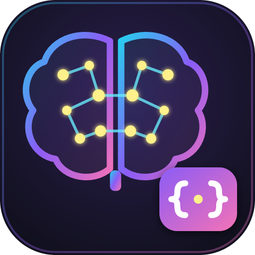

# Neurix for VS Code

**How many tokens? How much will it cost? Does it fit? Will it run on my GPU?** 
Neurix answers all of it inside VS Code, in 🇺🇸 English and 🇧🇷 Portuguese.

[English](#english) · [Português](#portugues)

## ✨ Features

- **📊 Live token counter in the status bar**: tokens of the selection (or the whole file) and what it costs on your default model, in US$ and R$. Hover for the breakdown and context-window usage, click to compare every model.
- **🧠 Neurix sidebar** with all **23 tools**, grouped:
  - **Tokens & cost**: count tokens, tokens and cost of a file, cost of one call, compare models, recommend the cheapest model, models and prices, USD → BRL rate.
  - **Prompt, data & RAG**: optimize a prompt (find wasted tokens), cheapest data format (JSON/YAML/CSV/Markdown), chunk a document, RAG vs whole document, tokens per file in a folder, prompt caching savings.
  - **Budget & alerts**: Neurix Budget (monthly cap, projection, the day it runs out, caching and batch) and cost alert (max US$, R$ or tokens).
  - **Local models**: detect GPU/VRAM/RAM, installed Ollama and LM Studio models, does a model fit my GPU, models that fit my GPU, import from Hugging Face, local vs API, real Ollama benchmark.
  - **Learn**: glossary (token, chunk, embedding, quantization, KV cache…).
- **🪄 Context menus**: right-click a selection (Editor → *Neurix*) or a file/folder (Explorer → *Neurix*). Fields are filled from the selection, the open file or the workspace, and the result appears right away.
- **📋 Results as tables**, with *Copy JSON*, *Open JSON* and *Export Markdown*.
- **🤖 MCP server for Copilot**: the extension registers the Neurix MCP server, so Copilot agent mode (and other MCP clients in VS Code) can use all 23 tools. Nothing to install: it runs on VS Code's own runtime.
- **🖥️ Interactive CLI**: *Neurix: Open interactive menu (terminal)* opens the animated Neurix menu in the integrated terminal.

Token counts are **exact** for OpenAI (js-tiktoken) and local models (Hugging Face tokenizers), and **estimates** for Claude and Gemini (their tokenizers are not public). Neurix always says which.

## ⌨️ Shortcuts

| Shortcut | Command |
|---|---|
| `Ctrl+Alt+T` / `Cmd+Alt+T` | Count tokens of the selection/file |
| `Ctrl+Alt+M` / `Cmd+Alt+M` | Compare models |

Every tool is also in the Command Palette under **Neurix:**.

## ⚙️ Settings

| Setting | Default | What it does |
|---|---|---|
| `neurix.language` | `auto` | `auto`, `pt` or `en` |
| `neurix.defaultModel` | `claude-sonnet-5-5` | Model for the status bar and pre-filled tools (*Neurix: Select default model*) |
| `neurix.outputTokens` | `300` | Expected answer size used in estimates |
| `neurix.iofPct` | `0` | Brazilian IOF tax in % applied to R$ values |
| `neurix.usdBrl` | live | Manual USD→BRL rate |
| `neurix.statusBar.enabled` | `true` | Status bar counter |
| `neurix.statusBar.showCost` | `true` | Show cost in the status bar |
| `neurix.statusBar.maxFileSizeKB` | `2048` | Larger files aren't counted automatically |
| `neurix.offline` | `false` | Don't download price updates or tokenizers |
| `neurix.mcp.enabled` | `true` | Offer the MCP server to Copilot |

Prices update daily from the Neurix repository (24 h cache) and fall back to the table bundled with the extension when offline.

---

## ✨ Recursos

- **📊 Contador de tokens na barra de status**: tokens da seleção (ou do arquivo inteiro) e quanto custa no seu modelo padrão, em US$ e R$. Passe o mouse para ver os detalhes e o uso da janela de contexto; clique para comparar todos os modelos.
- **🧠 Barra lateral do Neurix** com as **23 ferramentas**:
  - **Tokens e custo**: contar tokens, tokens e custo de um arquivo, custo de uma chamada, comparar modelos, recomendar o modelo mais barato, modelos e preços, cotação do dólar.
  - **Prompt, dados e RAG**: otimizar prompt, formato mais barato (JSON/YAML/CSV/Markdown), dividir em chunks, RAG × documento inteiro, tokens por arquivo da pasta, economia com prompt caching.
  - **Orçamento e alertas**: Neurix Budget (teto mensal, projeção, dia em que acaba, cache e batch) e alerta de custo (máximo em US$, R$ ou tokens).
  - **Modelos locais**: detectar GPU/VRAM/RAM, modelos instalados no Ollama e LM Studio, cabe na minha GPU?, modelos que cabem na GPU, importar do Hugging Face, local × API, benchmark real com Ollama.
  - **Aprender**: glossário (token, chunk, embedding, quantização, KV cache…).
- **🪄 Menus de contexto**: clique com o botão direito numa seleção (Editor → *Neurix*) ou num arquivo/pasta (Explorer → *Neurix*). Os campos vêm preenchidos e o resultado aparece na hora.
- **📋 Resultados em tabelas**, com *Copiar JSON*, *Abrir JSON* e *Exportar Markdown*.
- **🤖 Servidor MCP para o Copilot**: a extensão registra o servidor MCP do Neurix; o modo agente do Copilot usa as 23 ferramentas. Não precisa instalar nada.
- **🖥️ CLI interativo**: *Neurix: Open interactive menu (terminal)* abre o menu animado no terminal integrado.

Configure o idioma com **Neurix: Idioma / Language** ou `neurix.language`.

---

MIT · [GitHub](https://github.com/Aspael/Neurix) · CLI: `npm install -g aspael-neurix`

